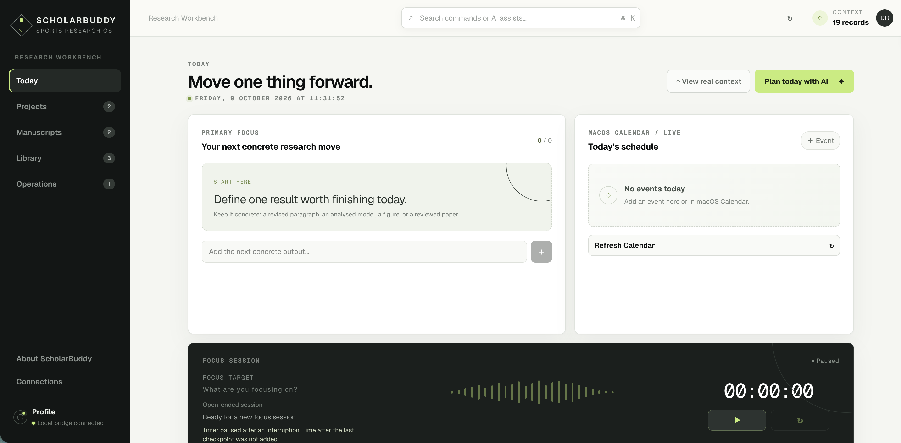

# ScholarBuddy — Sports Research OS

ScholarBuddy is a local-first research workbench for sports science and other evidence-heavy research. The hosted interface organizes projects, manuscripts, reading, reviews, submissions, the daily research log, captured ideas, and daily focus. A loopback-only Bridge keeps Obsidian, Zotero, macOS Calendar, and macOS Mail on the researcher's own computer.



## Architecture

```text
Hosted ScholarBuddy UI (any Next.js-compatible deployment)
                         |
                 exact-origin CORS
                 + paired browser
                         |
           http://127.0.0.1:32145
                  Local Bridge
           /        |       |       \
      Obsidian   Zotero  Calendar   Mail
           \        /       |       /
        Native Reminders (macOS)
                         |
                 optional AI APIs
```

The hosted site contains no provider API keys, Zotero library, Obsidian vault, calendar, or mailbox data. Each visitor runs and pairs their own Bridge. Browser-only focus state and preferences stay in that browser.

## Requirements

- Node.js 22.13 or newer.
- npm and a modern desktop browser with local-network access enabled.
- An Obsidian-compatible Markdown vault for persistent ScholarBuddy records.
- Zotero Desktop with its Local API enabled for live literature features.
- macOS for Calendar, Mail, and native reminder integration (the web UI and other Bridge features run on any OS).
- Optional DeepSeek, Kimi, OpenAI, Anthropic, xAI, or Gemini API credentials for AI workflows. Users supply their own keys.

## Local setup

```bash
npm install
npm run setup
```

On macOS, setup installs the per-user background Bridge and opens a private page at `http://127.0.0.1:32145/setup`. Use it to:

- Store optional AI credentials in macOS Keychain.
- Test an exact provider model before saving it; the check sends one short request and does not persist the draft key or model.
- Choose an Obsidian vault with the system folder picker.
- Detect Zotero Desktop and request Calendar permission.
- Return to ScholarBuddy and pair the same browser automatically.

The setup page is loopback-only, uses a short-lived setup session, and never returns a saved API key to browser JavaScript. Advanced users and other operating systems can edit the generated `.env.local` directly:

- Set `OBSIDIAN_VAULT_PATH` to an absolute vault path.
- Add any optional AI provider credentials.
- Override the matching `*_MODEL` value if your account uses a different available model.
- For local development, run `npm run setup -- --dev` once. It adds `http://localhost:3000`, `:5173`, and `:4173` to `SCHOLARBUDDY_ORIGINS`; they are left out by default because whatever listens on those ports could then use the Bridge.
- After deployment, add every exact public origin. Wildcards are rejected, and an origin must be `https` unless it is this computer's own `http://localhost`.

For local development, start the interface and Bridge in separate terminals:

```bash
npm run dev
npm run bridge
```

Open ScholarBuddy → Connections → Configure this Mac for guided setup. Manual pairing remains available from the local pairing page; its code expires after five minutes. The resulting private token is stored only in that browser origin.

## macOS background service

The installer generates a per-user LaunchAgent using the current Node executable and repository path; no developer-specific paths are committed.

```bash
npm run bridge:install
npm run bridge:status
npm run bridge:uninstall
```

Each site a browser pairs with receives its own credential. It works only from that site's origin, lapses 30 days after it was last used or 180 days after pairing, and is stored on this Mac only as a hash. The setup page (**Connections → Manage local connections**) lists the paired browsers and lets you limit one to reading or revoke it; **Disconnect this browser** revokes the one you are using. To revoke every paired browser at once:

```bash
npm run bridge:token:rotate
```

Setting `SCHOLARBUDDY_BRIDGE_TOKEN` opts out of all of this for automation: one fixed credential shared by every allowed origin, which never lapses and which `npm run bridge:token` prints.

## Optional reminders

Open **Connections** in the sidebar to configure reminders. Reminders default to off. First enable selects both categories:

- Calendar events: 24 elapsed hours before; all-day events at 09:00 the previous day.
- Operations deadlines (including Conference): one calendar month, seven days,
  and one day before, at 09:00 in this Mac's time zone. Month ends are clamped.

No new fields or per-item setup are needed. Today tasks are excluded. Completed,
archived, deleted, and rescheduled items are reevaluated automatically. Missed
nodes for still-upcoming items are combined; expired items are not notified.

On macOS, first enable prepares a small local notification helper and asks for
notification permission, plus Calendar read access if that category is selected.
Building the helper requires Apple's Command Line Tools; existing users restart
the updated Bridge once. You can also compile it ahead of time with
`node scripts/build-reminder-helper.mjs`. The background Bridge checks every minute,
so the page can be closed. Delivery requires the Mac to be awake and the Bridge running;
macOS Focus can silence banners. Use **Send test reminder** after granting access.
Settings and retry/deduplication state remain on this Mac. Switching off keeps
category choices but stops future reminders. There is no global OS keyboard shortcut.

## Deployment and domains

The app is a standard Next.js App Router project. Production is built with `npm run build:next` (`next build`), which `vercel.json` pins. `next.config.ts` sets the fixed security headers, and `proxy.ts` mints a nonce for every page and sends the Content Security Policy that allows scripts by that nonce only, never by `'unsafe-inline'`. `vite.config.ts` and `worker/` provide the Vinext/Cloudflare Worker build used for local development and staging; the Worker applies the same headers and policy from `shared/security-headers.mjs`. Social-preview addresses are built from the host a request was routed by; a deployment behind its own reverse proxy sets `NEXT_PUBLIC_SITE_URL` to its public origin.

The public custom domain is `https://scholarbuddy.tech`, which redirects to `https://www.scholarbuddy.tech`. The fixed backup entry point is [scholarbuddy-eta.vercel.app](https://scholarbuddy-eta.vercel.app). All three exact origins are included in the example Bridge allowlist. Keep the Vercel address serving the app directly so it remains usable independently of the custom domain.

### Pair the backup entry point in advance

New installations include the backup origin automatically. Existing installations keep their own `.env.local` when running `npm run setup`: append `https://scholarbuddy-eta.vercel.app` to the existing `SCHOLARBUDDY_ORIGINS` value and restart the Bridge. On macOS, `npm run bridge:install` restarts the background service; manually started Bridges should be stopped and started again with `npm run bridge`.

Retiring the backup has an order. A `vercel.app` name that is deleted or renamed can be claimed by someone else, and a browser that was paired there still holds its credential for that origin. Before the deployment goes away, publish a release whose example allowlist no longer contains it, ask existing users to remove it from `SCHOLARBUDDY_ORIGINS`, and rotate Bridge tokens that were paired there.

Open the backup address on the same Mac, then choose **Connections → Open local pairing page**. Copy the new five-minute, one-time code into the backup site's **Temporary pairing code** field and choose **Pair bridge**. Pair each browser you intend to use and bookmark the backup address. Once paired, that browser can connect from the backup address while its stored token remains valid, even if the custom domain is unavailable.

Both entry points use the same local Bridge, Obsidian vault, and Zotero library. Browser storage is separate for each origin, so pairing, browser preferences, and unsaved drafts do not transfer between them. If browser storage is cleared or the Bridge token is rotated, generate a new code and pair again.

### Independent Cloudflare staging

`npm run deploy:cloudflare:staging` builds and publishes the independent
`scholarbuddy-staging` Worker in your authenticated Cloudflare account. Run
`npx wrangler login` first if necessary. This mode uses a `workers.dev` address,
and has no custom-domain routes or database bindings.
The existing default build and production domain configuration are preserved.
It shares the ignored `dist/` output directory, so always use the complete deploy
command above to rebuild the intended target before publishing.

To check the upload without publishing:

```bash
npm run build:cloudflare:staging
npx wrangler deploy --config dist/server/wrangler.json --dry-run
```

After deployment, append the exact HTTPS origin printed by Wrangler to the local
`SCHOLARBUDDY_ORIGINS` allowlist, restart the Bridge, and pair the browser from that
origin. Keep the existing production and local origins. Browser preferences are
separate for staging. Staging pairs with the same local Bridge and therefore can
read and change the same vault records; use a separate test vault for destructive
testing. AI credentials remain local and must not be added to Worker variables.

The staging Worker sends `X-Robots-Tag: noindex, nofollow`; this discourages search
indexing but is not access control. The unused image optimization route returns
404 in staging, while the application's static images are served normally.

## Data and security model

- The Bridge binds only to `127.0.0.1` and validates loopback `Host` headers.
- CORS accepts only exact configured origins; browser requests require a bearer credential. An origin must be `https` unless it is this computer's own `http://localhost`.
- Pairing is a grant of trust in that site. Until the browser is disconnected, pages from a paired origin can read and change what the Bridge exposes: the vault, the Zotero library, Calendar, submission mail matches, and AI runs on your keys. Scripts on the hosted page therefore run under a per-request nonce policy; each site's credential is its own, expires, and can be limited to reading or revoked from the local setup page.
- Pairing pages expose a short-lived one-time code, never a credential. The code the setup page sends a browser back with only works at the site it was sent to.
- On macOS, API keys are stored in Keychain (`.env.local` fallback) and are never sent to the hosted UI.
- Obsidian writes use constrained collections, atomic writes, version archives, and SHA-256 `contentHash` concurrency protection against stale overwrites.
- Record frontmatter is written as one JSON value per line. A list that Obsidian rewrites in YAML's own spelling (`[a, b]`, or one `- item` per line) is read back as the same list. Nested YAML maps and multi-line strings are not preserved when ScholarBuddy next saves that record; the previous version stays in `ScholarBuddy/.history`.
- An AI answer says so when the vault search behind it stopped at the first 2,500 notes; the passage library and the submission mail check report what lay beyond their limits in the same way.
- AI answers are written to the vault with image embeds turned into plain links and resource-loading HTML turned into text, so a note cannot fetch anything by being opened.
- A note that cannot be loaded — an unreadable date, a file name that is not a record id, a sync-conflict copy — is listed in a banner with its path and reason and left untouched. Every other record loads as usual.
- Focus sessions are written to macOS Calendar only after you choose a calendar under **Connections → Focus sessions**. The setting starts off.
- Research log entries and captured ideas are ordinary Obsidian records, held in browser memory only until written to the vault.
- Selected Zotero and Obsidian context is sent to an AI provider only during explicit workflow execution; evidence snapshots are preserved across follow-ups, and logs redact credentials.
- Submission email checks require confirmation for consequential status updates; retries recover attempt state idempotently.
- Reminder schedules, outboxes, and deduplication remain strictly on this Mac under `bridge/.notifications/state` and are never sent to AI providers.
- Record history is retained under `ScholarBuddy/.history`. “Delete permanently” removes both the live note and every archived version.

See [PRIVACY.md](PRIVACY.md) and [SECURITY.md](SECURITY.md) before sharing a deployment.

## Language

The interface is available in English and Simplified Chinese. Switch with the round language button at the right of the top bar (**中** in English, **EN** in Chinese); without a choice, the browser's language decides. Records keep their statuses, stages, and section names in English in the vault, so a vault reads the same whichever language each browser uses. AI answers follow the interface language, except drafting and reviewing manuscript sections, which stay in English.

The Bridge follows the same choice. The workbench sends the interface language with every Bridge request (as `Accept-Language`, which an older Bridge simply ignores), so unreadable-note reasons, coverage notes, and Bridge errors arrive in that language. The setup and pairing pages open in it and have their own **EN | 中文** switch. Reminder notifications are written in the language the workbench last used with this Bridge. The macOS permission prompt of the reminder helper follows the Mac's own language.

Interface strings live in `app/i18n/en.ts` (the source of truth) and `app/i18n/zh.ts`, which the compiler holds to the same keys; the user guide is in `app/i18n/guide.ts`. The Bridge's are in `bridge/messages.mjs`. Log output, the command line, and refusals of malformed requests stay English.

## Personal activity profile

Open **Profile** in the sidebar or user avatar to review research habits and productivity:

- **Focus**: Tracks daily and lifetime deep work sessions, daily averages, streaks, and trends across Daily, Weekly, and Cumulative views.
- **Operations**: Shows the focus time spent on operations, started with **Focus** on an operation card, by type and by operation, and as a share of all focus.
- **AI activity**: Monitors token volume, active streaks, session lengths, and provider coverage.

Activity metrics are saved in the local ledger (`bridge/.activity/activity-v1.json`). A focus session started from an operation keeps only the operation's id and type; titles are read from the vault. AI conversation text and provider credentials are never stored.

## Development

```bash
npm run lint
npm run typecheck
npm test
npm run build:next
```

`npm test` performs the Vinext build and runs Bridge and server-rendering tests; `npm run build:next` is the build production serves. Pull requests run all four in GitHub Actions.

## Contributing

Contributions are welcome. Read [CONTRIBUTING.md](CONTRIBUTING.md) and [CODE_OF_CONDUCT.md](CODE_OF_CONDUCT.md) first. Security reports should follow [SECURITY.md](SECURITY.md), not a public issue.

## License

Copyright 2026 Jiangyan Yang.

Licensed under the Apache License, Version 2.0. See [LICENSE](LICENSE).
